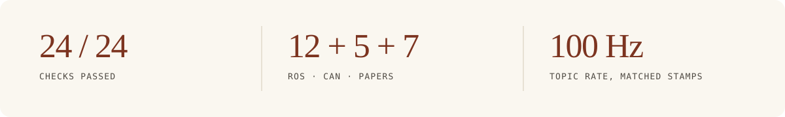
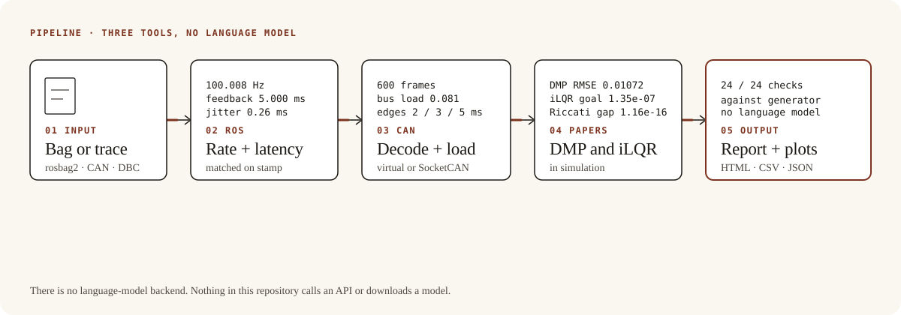
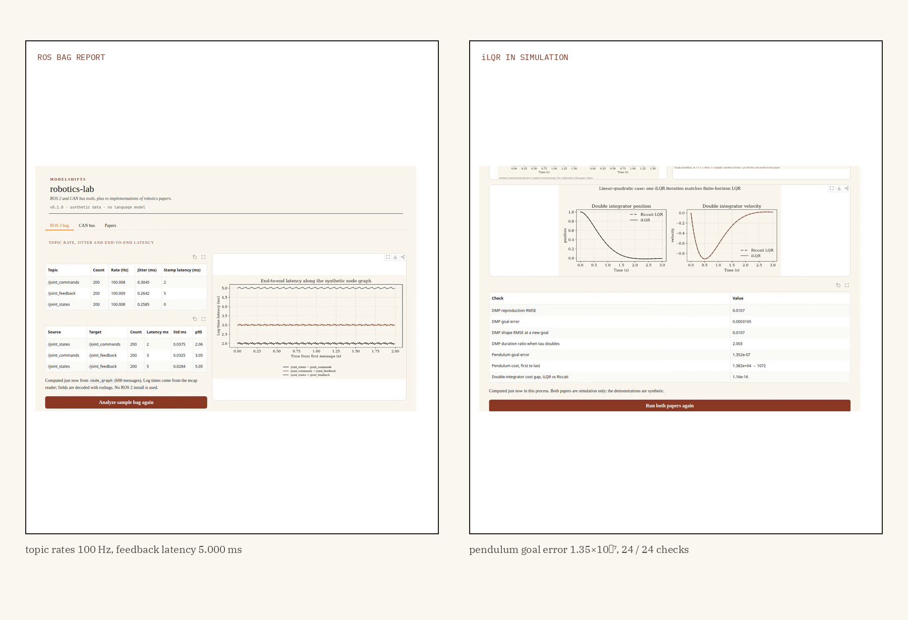

<p align="center">
  
</p>

<p align="center"><strong>A rosbag or a CAN trace goes in. Rates, latency and jitter come out. Two paper methods run in simulation.</strong></p>

<p align="center">
  <a href="https://github.com/ModelShifts/robotics-lab/actions/workflows/ci.yml"></a>
  
  
  
  
</p>

<p align="center">
  
</p>
<p align="center"><sub>Web demo (<a href="assets/demo.mp4">MP4</a>). The plots are computed in the page from the samples. No model is used.</sub></p>

<p align="center">
  
</p>

## The problem

Imagine a joint loop on the bench: a sensor, a controller, a plant. You want the topic rate, the end-to-end latency, the jitter, and the same measurements on the CAN traces that travel with it — and, next to those, a chance to run the paper methods you are reading, from the published equations, in simulation.

The useful result is a report you can check against the bag, plus two paper methods — discrete dynamic movement primitives and iterative LQR — that run from those equations.

## How it works

Three tools, and no language model.

1. A rosbag2 (mcap) of a node graph comes in — here, a joint sensor, a controller and a plant, written by a pure-Python simulator. Reading the bag does not need a ROS 2 install.
2. Topic rates, inter-arrival jitter and end-to-end latency (matched on `header.stamp`) are reported as HTML, CSV or JSON.
3. A CAN trace is decoded with a DBC file and scored the same way: rate, jitter, Sequence-matched latency, and a bus-load estimate. The logger records a python-can virtual bus by default, or SocketCAN when the channel exists.
4. Discrete DMPs (Ijspeert, Nakanishi, Hoffmann, Pastor and Schaal, 2013) and iterative LQR (Li and Todorov, 2004) run in simulation — a minimum-jerk path for the DMP, a pendulum for iLQR, and finite-horizon LQR on a double integrator as the linear special case.
5. You get the report and the paper figures.

<p align="center">
  
</p>
<p align="center"><sub>There is no language-model backend. Nothing in this repository calls an API or downloads a model.</sub></p>

One of the samples, beside a paper figure:

<p align="center">
  
</p>
<p align="center"><sub>Rosbag2 and iLQR on a pendulum. 24/24 checks passed. <a href="scripts/evaluate.py"><code>scripts/evaluate.py</code></a>.</sub></p>

## Results

On the rosbag, the CAN trace, and the two paper methods in simulation, [`scripts/evaluate.py`](scripts/evaluate.py) passed **24 of 24 checks** against the generator settings: 12 ROS, 5 CAN, 4 DMP and 3 iLQR.

| Group | Passed | Highlights (measured) |
|---|---|---|
| ROS bag (12) | 12/12 | Topic rates 100.007–100.009 Hz (expected 100.0 ± 0.02). Stamp latencies 0, 2.000000 and 5.000000 ms. Edges 2.000000, 3.000000 and 5.000000 ms (n=200). Jitter inside 0.15–0.45 ms on every topic. |
| CAN (5) | 5/5 | 600 frames, unknown 0. Bus load 0.081199 (expected about 0.081). Edges 2.000000, 3.000000 and 5.000000 ms. |
| DMP (4) | 4/4 | Reproduction RMSE 0.01072, goal error 0.000316, shape RMSE at a new goal 0.01072, time-scale ratio 2.0027. |
| iLQR (3) | 3/3 | Cost 1.382×10⁴ → 1072 in 6 steps, monotone. Pendulum goal error 1.35×10⁻⁷. Riccati relative cost gap 1.16×10⁻¹⁶ on the double integrator. |
| **All** | **24/24** | |

**Methodology.** The thresholds are the generator settings (or a bound around them). The rosbag is a pure-Python simulation of a joint sensor, a controller and a plant; the CAN trace is decoded with the committed DBC. DMP follows Ijspeert et al., Neural Computation, 2013, on a minimum-jerk path plus a negative Gaussian bump. iLQR follows Li and Todorov, ICINCO 2004, on one pendulum. [`python scripts/evaluate.py`](scripts/evaluate.py), 12 November 2026. The full 24-row table is in [`docs/eval.md`](docs/eval.md). Samples are in [`samples/`](samples/).

## Why it matters

A latency number without the bag it came from is a rumour. A report matched on `header.stamp`, next to the same measurements on the CAN trace, is a claim you can check — and the paper figures are a chance to run the equations, not only to look at a plot from the PDF.

The tools read standard rosbag2 mcap and a DBC-decoded CAN log, so they fit next to a recorder a team already has.

## Quickstart

Python 3.11 or newer.

```bash
git clone https://github.com/ModelShifts/robotics-lab
cd robotics-lab
python -m venv .venv && source .venv/bin/activate
pip install -e ".[demo]"
cp .env.example .env
```

```bash
# topic rate, end-to-end latency and jitter on the node graph
robotics-lab ros analyze samples/ros/node_graph

# record the virtual bus, decode with the DBC, write CSV and Parquet
robotics-lab can log --interface virtual --channel robotlab --dbc samples/can/robot.dbc --seconds 1 --out out/can

# the same measurements on the committed trace (no live bus)
robotics-lab can analyze samples/can/trace.csv --dbc samples/can/robot.dbc

# paper figures
robotics-lab papers dmp --out out/dmp
robotics-lab papers ilqr --out out/ilqr

# the web demo at http://127.0.0.1:7860 (python app.py does the same)
robotics-lab serve
```

`ros analyze` also accepts `--csv`, `--html` and `--json`. `can analyze` does too.

`samples/` holds the rosbag and CAN trace, with generator settings as ground truth. Tests need no downloads: `pip install -e ".[dev]" && pytest`.

## Backends

<details>
<summary>There is no language-model backend.</summary>

Nothing in this repository calls an API or downloads a model. The tools depend on `rosbags`, `mcap`, `python-can` and `cantools`, and on NumPy for the paper methods. Reading a bag does not need a ROS 2 install. A bag can still be opened with `ros2 bag` where ROS 2 is installed.

python-can is LGPL-3.0. cantools (MIT) depends on it. The other direct dependencies are MIT, BSD or Apache-2.0.

</details>

## Roadmap

- [ ] Live ROS 2 nodes under rclpy
- [ ] CAN FD, and SocketCAN checked on hardware
- [ ] Rhythmic DMPs
- [ ] Control limits in iLQR

## License

[MIT](LICENSE) © Modelshifts Technology Pte. Ltd.

<p align="center"><sub>Part of the <a href="https://modelshifts.com/work">Modelshifts</a> showcase. November 2026, v1.</sub></p>
