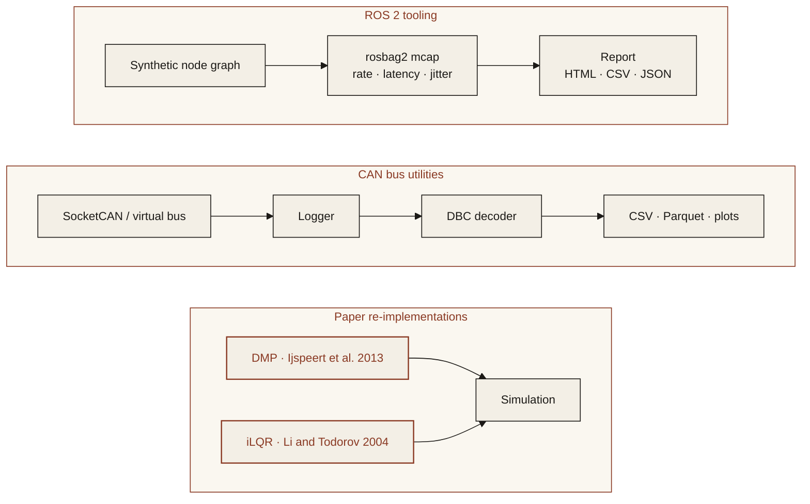

<p align="center">
  
</p>

<p align="center"><em>ROS 2 and CAN bus tools, plus re-implementations of robotics papers.</em></p>

<p align="center">
  
  
  
  
</p>

---

## Features

All 3 features below work in v1. See [Limitations](#limitations) for what they do not cover.

- **ROS 2 node and latency tooling**: measure topic rates, end-to-end latency and jitter on a rosbag2 (mcap) recording of a node graph. The included graph is a joint sensor, a controller and a plant, written by a pure-Python simulator. Reading the bag does not need a ROS 2 install.
- **CAN bus logging and decoding**: record from a python-can bus (virtual by default, SocketCAN when the channel exists), decode with a DBC file, and export CSV or Parquet. A second command reports per-message rate, jitter, Sequence-matched latency and bus load.
- **Paper re-implementations in simulation**: discrete dynamic movement primitives (Ijspeert, Nakanishi, Hoffmann, Pastor and Schaal, 2013) and iterative LQR (Li and Todorov, 2004) on a pendulum, with finite-horizon LQR on a double integrator as the linear special case.

<p align="center">
  
</p>
<p align="center"><sub>Web demo (<a href="assets/demo.mp4">MP4</a>). The plots are computed in the page from the synthetic samples. No model cache is used.</sub></p>

## Architecture



There is no language-model backend. Nothing in this repository calls an API or downloads a model.

## Quickstart

Python 3.11 or newer.

```bash
git clone https://github.com/ModelShifts/robotics-lab
cd robotics-lab
python -m venv .venv && source .venv/bin/activate
pip install -e ".[demo]"
cp .env.example .env
```

```bash
# topic rate, end-to-end latency and jitter on the synthetic node graph
robotics-lab ros analyze samples/ros/node_graph

# record the virtual bus, decode with the DBC, write CSV and Parquet
robotics-lab can log --interface virtual --channel robotlab --dbc samples/can/robot.dbc --seconds 1 --out out/can

# the same measurements on the committed trace (no live bus)
robotics-lab can analyze samples/can/trace.csv --dbc samples/can/robot.dbc

# paper figures
robotics-lab papers dmp --out out/dmp
robotics-lab papers ilqr --out out/ilqr

# the web demo at http://127.0.0.1:7860 (python app.py does the same)
robotics-lab serve
```

`ros analyze` also accepts `--csv`, `--html` and `--json`. `can analyze` does too.

### Samples and tests

`samples/ros/node_graph` is a rosbag2 mcap of the joint loop. `samples/can/trace.csv` is the same schedule as classical CAN frames, with `samples/can/robot.dbc`. Both are synthetic and regenerated by `scripts/make_samples.py`. `rosbags` is pinned because the mcap header contains its version; a different version would rewrite the bag bytes.

```bash
pip install -e ".[dev]"
python scripts/make_samples.py   # regenerate samples/
pytest                           # no network, no ROS install
python scripts/evaluate.py       # compare measurements with the generator settings
```

### Citations

- Ijspeert, A. J., Nakanishi, J., Hoffmann, H., Pastor, P., and Schaal, S. (2013). Dynamical movement primitives: learning attractor models for motor behaviors. Neural Computation, 25(2), 328–373.
- Li, W. and Todorov, E. (2004). Iterative linear quadratic regulator design for nonlinear biological movement systems. ICINCO.
- Anderson, B. D. O. and Moore, J. B. (1990). Optimal Control: Linear Quadratic Methods. Prentice Hall. The double-integrator example is the finite-horizon Riccati special case of the same iteration.
- Tassa, Y., Mansard, N., and Todorov, E. (2014). Control-limited differential dynamic programming. ICRA. Only the Q_uu regularization is used; control limits are not projected.
- Davis, R. I., Burns, A., Bril, R. J., and Lukkien, J. J. (2007). Controller Area Network (CAN) schedulability analysis: refuted, revisited and revised. Real-Time Systems, 35, 239–272. The bus-load estimate uses this worst-case frame length.

`robotics-lab papers list` prints the same citations.

## Limitations

- Live ROS 2 nodes are not included. Measuring a running graph needs rclpy, and this repository does not start a ROS 2 container in CI. The tools read and write rosbag2 mcap (CDR, ROS 2 Jazzy types) with `rosbags` and `mcap`, which do not need a ROS install. A bag can still be opened with `ros2 bag` where ROS 2 is installed.
- SocketCAN is passed through to python-can. It was checked only as a missing-channel error. The virtual bus is what the tests and the web demo record. On the virtual bus the logger also sends the synthetic joint-loop frames, because that channel otherwise has no traffic. A SocketCAN recording is passive.
- Bus load is a worst-case bit-stuffing estimate for classical CAN with 11-bit identifiers, including the 3-bit intermission. It is not a measurement of idle time on a wire, and it does not cover CAN FD.
- python-can is LGPL-3.0. cantools (MIT) depends on it. The other direct dependencies are MIT, BSD or Apache-2.0 (`rosbags` is Apache-2.0, `mcap` is MIT).
- The DMP figure follows the equations and the panel layout of Figure 1 in Ijspeert et al. 2013, on a synthetic minimum-jerk path plus a negative Gaussian bump. It is not a digitization of their plot. The rhythmic system from the same paper is not implemented. Basis widths are set from the center spacing with a constant the paper's Table 1 does not specify; see the note in `src/robotics_lab/papers/dmp.py`.
- iLQR follows Li and Todorov 2004 on one pendulum (angle measured from upright, started hanging down). It is not their biomechanical arm. Torque is unlimited.
- The samples and the paper demonstrations are synthetic. `scripts/evaluate.py` only checks these tools against the generator settings.
- No language model is used.

## Roadmap

- [x] Repository scaffold and README
- [x] ROS 2 topic rate and latency probes
- [x] CAN logger for SocketCAN and virtual buses
- [x] DBC decoding and export
- [x] First paper re-implementation in simulation
- [x] Second paper re-implementation in simulation
- [ ] Live ROS 2 nodes under rclpy
- [ ] CAN FD, and SocketCAN checked on hardware
- [ ] Rhythmic DMPs
- [ ] Control limits in iLQR

## License

[MIT](LICENSE) © Modelshifts Technology Pte. Ltd.

<p align="center"><sub>Part of the <a href="https://modelshifts.com/work">Modelshifts</a> showcase.</sub></p>
