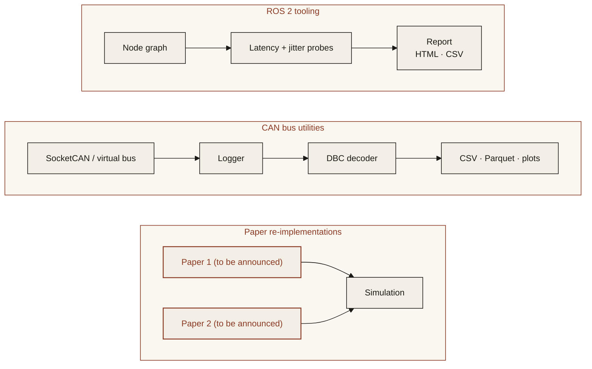

<p align="center">
  
</p>

<p align="center"><em>ROS 2 and CAN bus tools, plus re-implementations of robotics papers.</em></p>

<p align="center">
  
  
  
  
</p>

---

## Features

Planned for v1. Progress is tracked in the Roadmap below.

- **ROS 2 node and latency tooling**: measure topic rates, end-to-end latency and jitter across a node graph.
- **CAN bus logging and decoding**: record from SocketCAN or a virtual bus, decode with a DBC file, export to CSV or Parquet.
- **Paper re-implementations in simulation**: compact, readable re-implementations of selected robotics papers (to be announced).

## Architecture



## Quickstart

> **Coming soon.** The commands below show the planned interface.

```bash
git clone https://github.com/ModelShifts/robotics-lab
cd robotics-lab
cp .env.example .env   # CAN and ROS 2 settings
pip install -e .
robotics-lab ros latency --topic /joint_states
robotics-lab can log --channel vcan0 --dbc robot.dbc --out log.parquet
```

## Try it

> **Coming soon.** A hosted demo will be linked here and on [modelshifts.com/work](https://modelshifts.com/work).

## Roadmap

- [x] Repository scaffold and README
- [ ] ROS 2 topic rate and latency probes
- [ ] CAN logger for SocketCAN and virtual buses
- [ ] DBC decoding and export
- [ ] First paper re-implementation in simulation
- [ ] Second paper re-implementation in simulation

## License

[MIT](LICENSE) © Modelshifts Technology Pte. Ltd.

<p align="center"><sub>Part of the <a href="https://modelshifts.com/work">Modelshifts</a> showcase.</sub></p>
